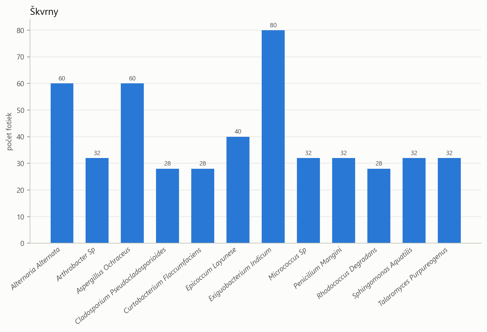
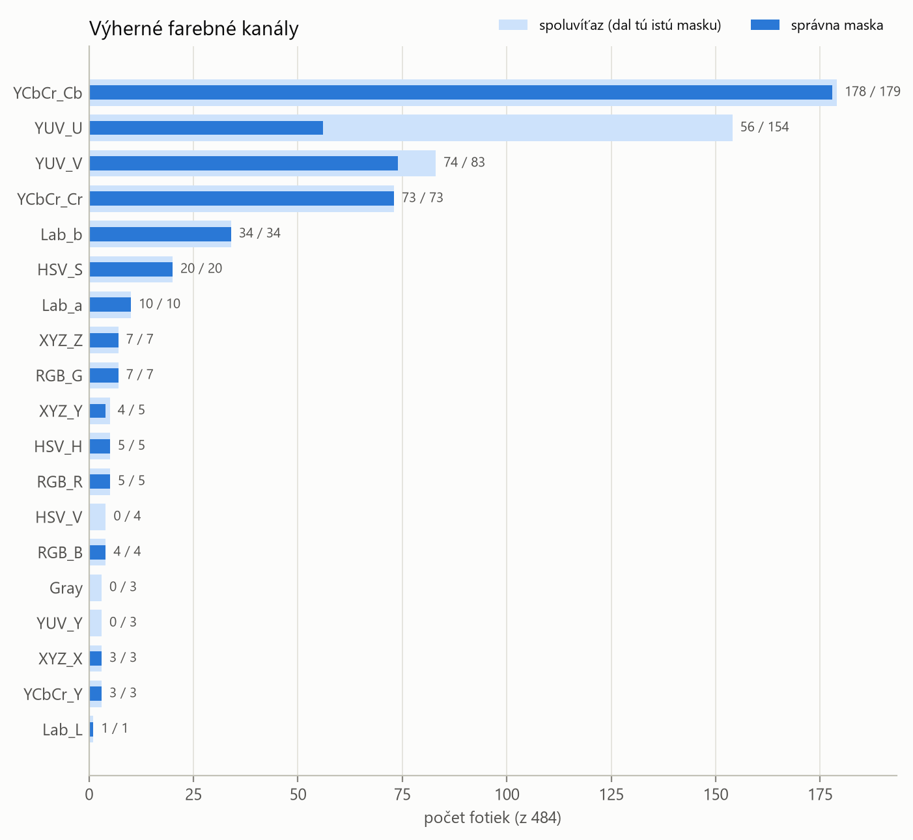
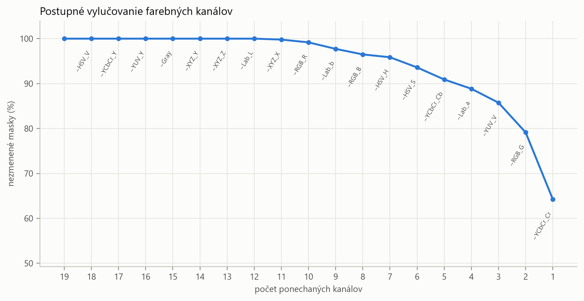
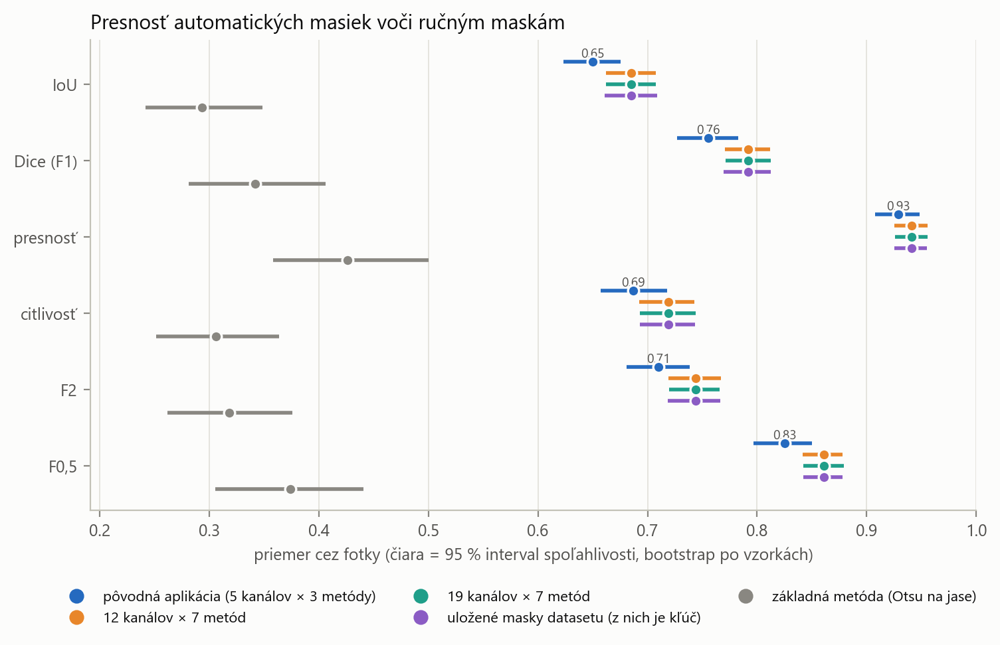
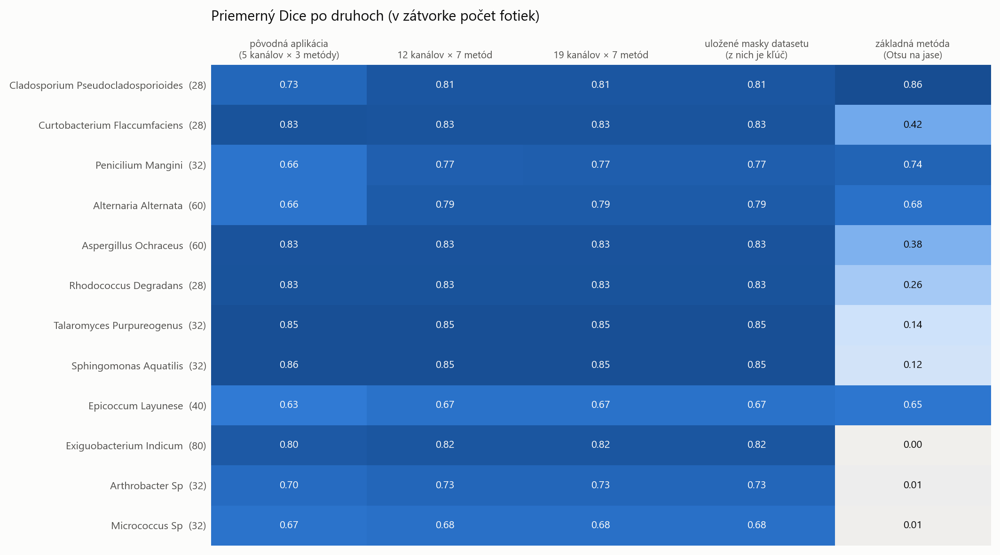
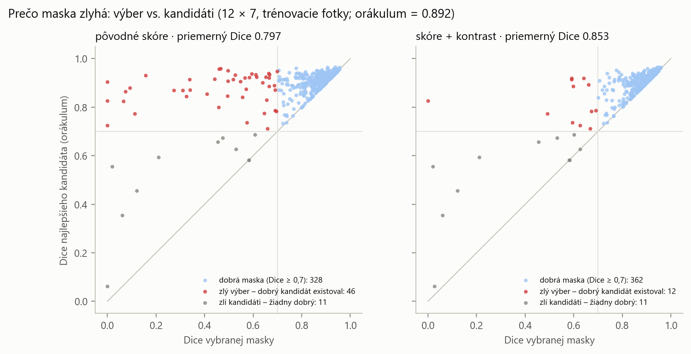
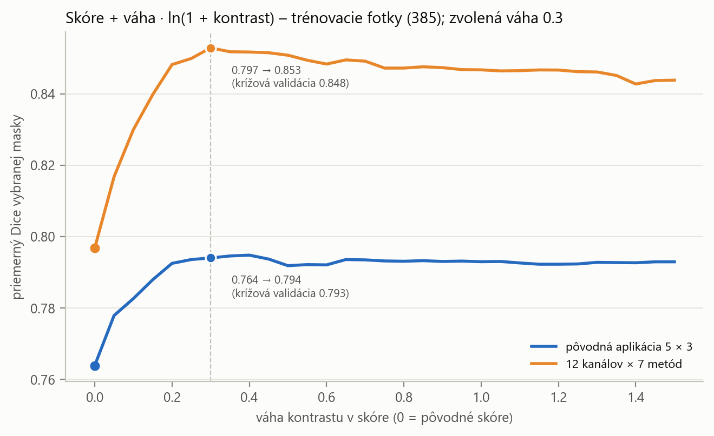
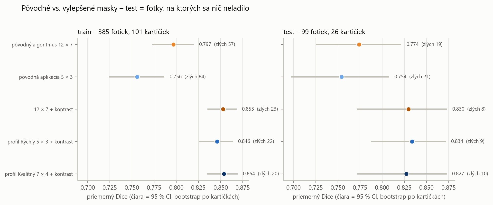
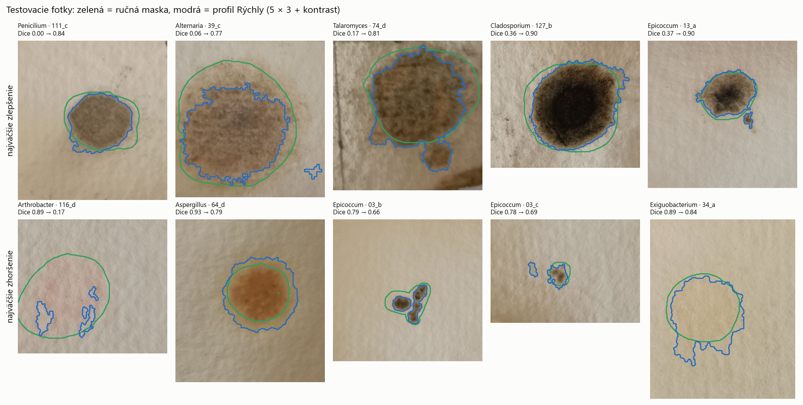

# Grafy z práce – maska škvrny

Grafy z kapitoly Výskum (sekcie Výber farebných kanálov a prahovacích metód a Presnosť
segmentácie). Vytvorili ich analytické skripty v `backend/backend_app/09_analyza_presnosti_masiek/`
(`presnost_masiek.py`, `vylepsenie_masky.py`), preto sa niektoré názvy v grafoch líšia od kódu
v `analyzy/`. Grafy, ktoré vytvárajú skripty tohto priečinka, sú v `../vysledky/`.

**Pojmy a sady, ktoré sa v grafoch porovnávajú:**

| názov v grafe | čo to je |
|---|---|
| 19 kanálov × 7 metód | plná sada: všetky farebné kanály × všetky prahovacie metódy |
| 12 kanálov × 7 metód | plná sada bez siedmich jasových kanálov (HSV_V, Lab_L, YCbCr_Y, XYZ_Y, XYZ_Z, YUV_Y, Gray) |
| pôvodné skóre | kruhovitosť + bonus za pokrytie − penalizácia za rozpad, bez kontrastu |
| + kontrast | skóre s kontrastom voči okoliu (`+ 0,3 · ln(1 + kontrast)`), ktoré algoritmus používa teraz |
| uložené masky | masky, z ktorých sa počítali črty pre staršiu verziu určovacieho kľúča (= sada 12 × 7 s pôvodným skóre) |
| základná metóda | Otsu na šedotónovom obrázku, škvrna tmavšia ako prah – najjednoduchší bežný prístup |
| profil Rýchly 5 × 3, Kvalitný 7 × 4 | prvá verzia profilov: HSV_H, HSV_S, YCbCr_Cr, YCbCr_Cb, XYZ_X × Otsu, Yen, ISODATA a RGB_R, HSV_H, HSV_S, YCbCr_Cr, YCbCr_Cb, XYZ_X, YUV_V × Otsu, Triangle, Yen, ISODATA |
| pôvodná aplikácia (5 × 3) | sada nahradená profilom Rýchly; v popisoch nižšie sa neuvádza |

Súčasné profily (Rýchly 4 × 3, Kvalitný 6 × 4) vznikli tým istým postupom znova v `analyzy/`
(`skvrny/vyber_kanalov.py`) a majú prakticky rovnakú presnosť ako prvá verzia: Rýchly 0,843 / 0,832
(train / test) oproti 0,846 / 0,834. Pozri [../docs/vyber_kanalov.md](../docs/vyber_kanalov.md).

Dice a IoU sú merané voči ručne obkresleným maskám. Interval spoľahlivosti je 95 % bootstrap,
v ktorom sa prevzorkúvajú celé kartičky (fotografie jednej kartičky nie sú nezávislé).

| graf | obrázok v práci |
|---|---|
| 04 | `obrazky/presnost_suhrn_metrik.png` |
| 06 | `obrazky/vyber_vs_najlepsi.png` |
| 07 | `obrazky/vaha_kontrastu.png` |
| 08 | `obrazky/test_porovnanie.png` |
| 09 | `obrazky/ukazky_zlepsenia.png` |

---

### 01 – Počet fotografií po druhoch

Počet fotografií (škvŕn) každého z 12 druhov. Dataset nie je vyvážený: najviac má
*Exiguobacterium indicum* (80 fotografií, 20 kartičiek), *Alternaria* a *Aspergillus* po 60,
najmenej *Cladosporium*, *Curtobacterium* a *Rhodococcus* po 28 (7 kartičiek). Preto sa presnosť
masiek uvádza aj po druhoch, nie len ako jeden priemer cez všetky fotografie.

### 02 – Víťazné farebné kanály

Na koľkých zo 484 fotografií dal daný kanál vybranú masku (tmavý stĺpec). Svetlá časť sú
spoluvýhry: kanál dal presne tú istú masku ako víťaz. Počítané pôvodným skóre s plnou sadou
19 × 7.

Najčastejšie vyhráva **YCbCr_Cb (36,8 %)**, ďalej YUV_V 15,3 %, YCbCr_Cr 15,1 %, YUV_U 11,6 % a
Lab_b 7,0 %. Jasové kanály (L, Y, V, Gray) nevyhrávajú takmer nikdy. Škvrna sa od papiera líši
hlavne **farbou, nie jasom**, a tieň alebo nerovnomerné svetlo mení jas, nie farbu.

So skóre s kontrastom vyhráva najčastejšie HSV_S (165 z 385 trénovacích fotografií), pozri
`../vysledky/vyhry_kanalov_a_metod.png` zo skriptu `vyber_kanalov.py`.

### 03 – Postupné vylučovanie kanálov

Os x je počet ponechaných kanálov a os y percento fotografií, ktorých maska ostala rovnaká
(IoU ≥ 0,9 voči maske plnej sady 19 × 7). V každom kroku sa vylúči kanál, bez ktorého sa masky
zmenia najmenej.

Prvých 7 vylúčených kanálov (HSV_V, YCbCr_Y, YUV_Y, Gray, XYZ_Y, XYZ_Z, Lab_L) **nezmení ani jednu
masku**. To je dôvod zoznamu `JASOVE_KANALY` v `maska.py` a sady 12 × 7. Pod približne 6 kanálov sa
masky začnú meniť. Graf meria, či sa maska zmení, nie či je správna. Správnosť voči ručným maskám
ukazujú grafy 04 a 08 a výber profilov voči ručným maskám je v `../docs/vyber_kanalov.md`.

### 04 – Presnosť algoritmu s pôvodným skóre

Každý riadok je jedna metrika a bod je priemer cez všetkých 484 fotografií. Čiara je 95 % interval
spoľahlivosti a farba označuje variant.

- Sada 12 × 7 s pôvodným skóre dosahuje **Dice 0,79** a IoU 0,69, kým základná metóda len
  **Dice 0,34**. Rozdiel je štatisticky veľmi významný (algoritmus je lepší na 102 zo 127 kartičiek).
  Algoritmus teda funguje aj bez akéhokoľvek ladenia na dátach.
- Vylúčenie jasových kanálov nič nestojí: sady 19 × 7 a 12 × 7 sú zhodné.
- Presnosť je vysoká (0,94), ale citlivosť nižšia (0,72). Automatická maska takmer nezachytí
  papier, no vynecháva rozmazaný okraj kolónie, takže je menšia ako ručná. Toto viedlo k skóre
  s kontrastom (grafy 06 a 07).

### 05 – Presnosť po druhoch

Priemerný Dice pre každý druh (riadok) a variant (stĺpec). V zátvorke je počet fotografií.

- Najťažšie druhy: *Epicoccum* (0,67), *Micrococcus* (0,68) a *Arthrobacter* (0,73). Majú
  nepravidelné okraje s výbežkami alebo veľmi bledé kolónie.
- Základná metóda úplne zlyháva na bledých baktériách (*Exiguobacterium*, *Arthrobacter*,
  *Micrococcus*, Dice ≈ 0). Nie sú tmavšie ako papier, len farebnejšie. To je priame
  zdôvodnenie, prečo sa maska hľadá vo farebných kanáloch, a nie v jase.

### 06 – Chyba výberu, alebo chyba kandidátov?

Každý bod je trénovacia fotografia. Os x je Dice masky, ktorú algoritmus vybral, a os y je Dice
najlepšieho kandidáta, teda masky, ktorú by vybral, keby poznal ručnú masku (orákulum).

- Červené body sú **chyby výberu**: dobrý kandidát existoval, ale skóre vybralo iného.
- Sivé body sú **chyby kandidátov**: žiadny kandidát nebol dobrý.

S pôvodným skóre (vľavo) bolo chýb výberu 46 a chýb kandidátov len 11. Chyba bola teda takmer
vždy vo výbere. Pôvodné skóre často vybralo len tmavé jadro škvrny, lebo je okrúhlejšie ako celá
škvrna s neostrým okrajom. Po pridaní kontrastu do skóre (vpravo) klesol počet chýb výberu na 12.

### 07 – Voľba váhy kontrastu

Os x je váha kontrastu v skóre (0 = pôvodné skóre) a os y priemerný Dice vybranej masky na
trénovacej množine pre sadu 12 × 7.

Krivka má plató približne od 0,2 do 1,3, takže na presnej hodnote takmer nezáleží. V 5-násobnej
krížovej validácii po kartičkách sa vo 4 z 5 foldov zvolila váha **0,3**. Dice na trénovacej
množine stúpne z 0,797 na 0,853.

### 08 – Overenie na testovacej množine

Priemerný Dice s 95 % intervalom: vľavo trénovacia množina, vpravo testovacia (26 kartičiek,
99 fotografií), na ktorej sa nič neladilo.

| variant | Dice train | Dice test |
|---|---|---|
| 12 × 7, pôvodné skóre | 0,797 | 0,774 |
| 12 × 7 + kontrast | 0,853 | 0,830 |
| **profil Rýchly** (prvá verzia 5 × 3) | 0,846 | **0,834** |
| profil Kvalitný (prvá verzia 7 × 4) | 0,854 | 0,827 |
| profil Rýchly (súčasný 4 × 3, nie je v grafe) | 0,843 | 0,832 |

- Samotné skóre s kontrastom zlepší sadu 12 × 7 o 0,056 (lepšia na 22 z 26 kartičiek, p = 0,0006).
- Rýchly a Kvalitný profil sa na testovacej množine nelíšia (p = 0,72). Zmenšenie zo 84 na 12–15
  kombinácií kanálov a metód merateľnú presnosť nestojí.
- Zlepšenie je na testovacej množine rovnako veľké ako na trénovacej, takže nejde o preučenie.
- Cenou za vyššiu citlivosť (0,70 → 0,82) je mierne nižšia presnosť (0,95 → 0,91): maska je väčšia
  a občas zachytí kúsok okolia, celkovo je však bližšie k tomu, ako škvrnu obkreslí človek.

### 09 – Ukážky masiek profilu Rýchly

Testovacie fotografie s najväčším zlepšením (horný riadok) a zhoršením (dolný riadok) profilu Rýchly
(prvá verzia) oproti sade 5 × 3 s pôvodným skóre; v nadpise je Dice pred a po. Zelená je ručná maska,
modrá profil Rýchly. V hornom riadku maska ide
až po okraj škvrny, v dolnom zachytí kúsok okolia alebo, pri bledom *Arthrobacter*, len časť
kolónie. Obrázok s anglickými popismi je
`backend/backend_app/09_analyza_presnosti_masiek/grafy/12_ukazky_zlepsenia_bez_povodnej_en.png`.
