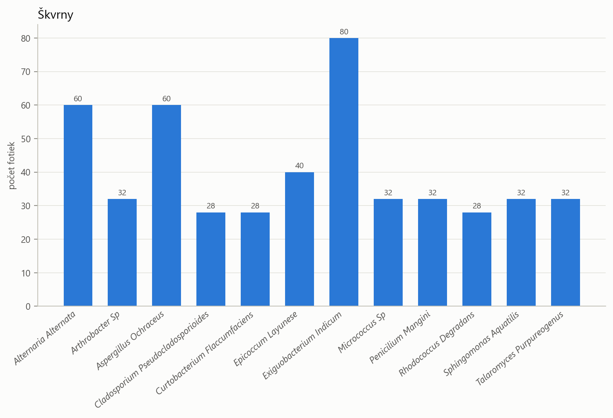
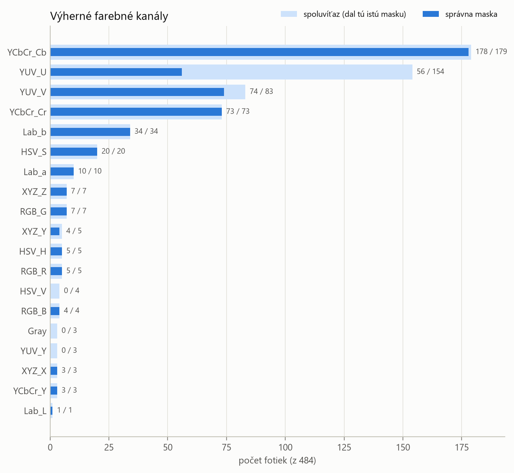
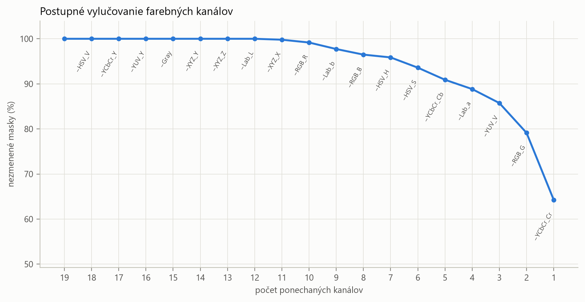
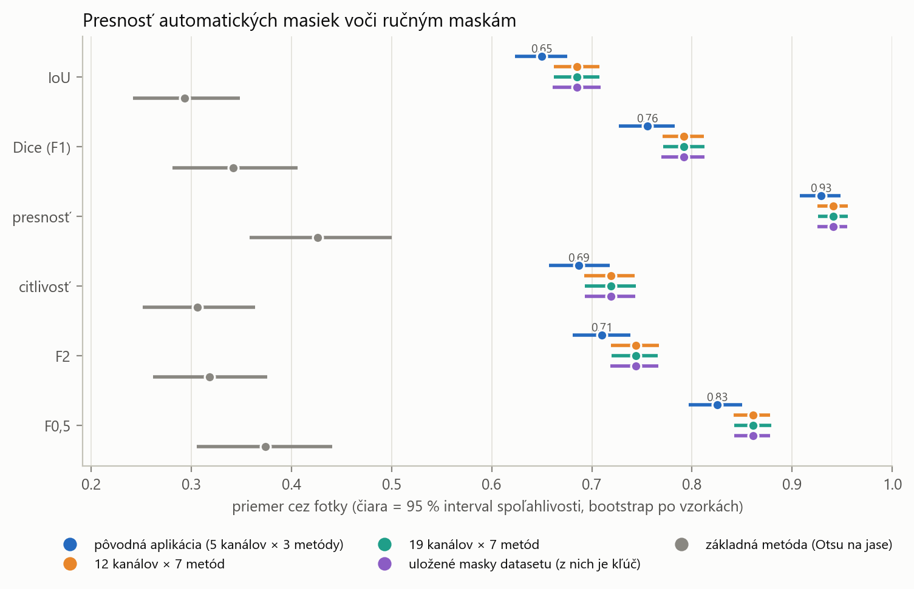
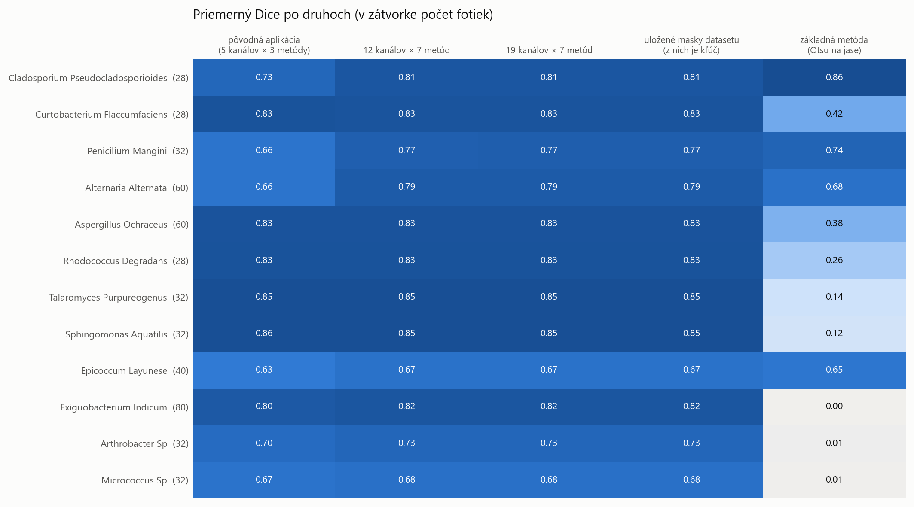
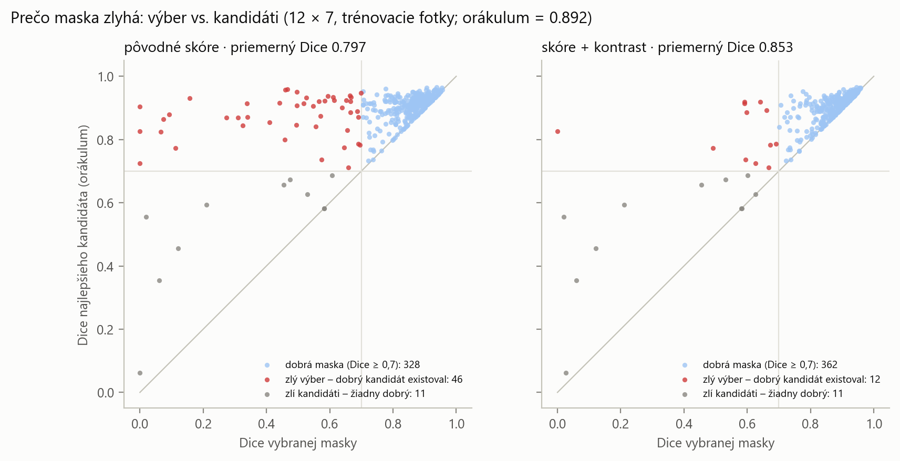
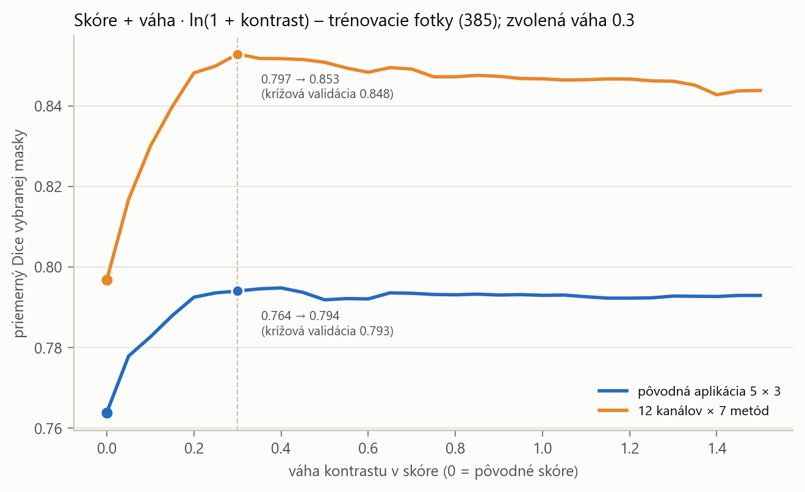
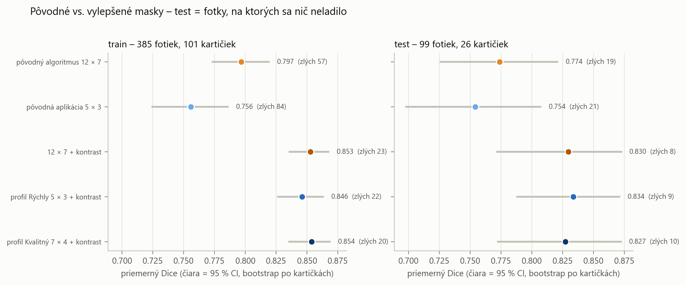
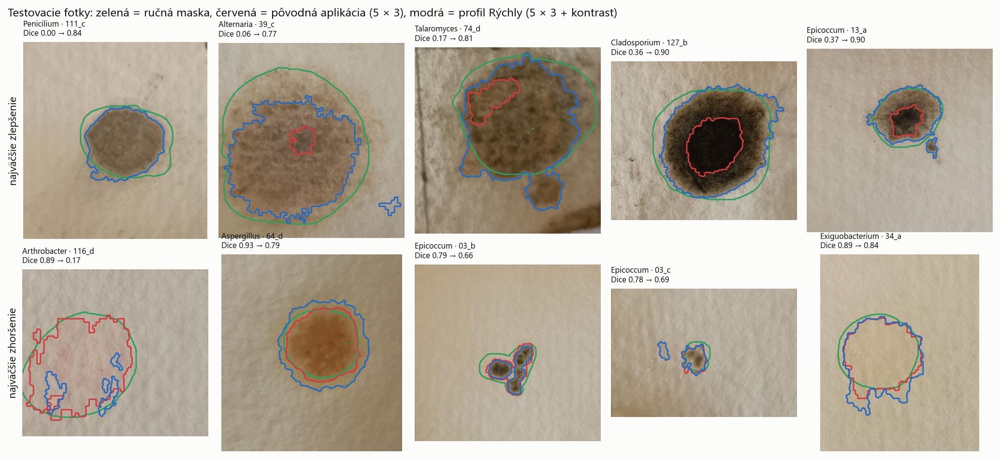

# Grafy z práce

Grafy z pôvodnej analýzy masiek v diplomovej práci. Vytvorili ich staršie analytické skripty
(nie sú v tomto repozitári), preto sa niektoré názvy v grafoch líšia od kódu. Grafy, ktoré
vytvárajú skripty tohto repozitára, sú v `vysledky/`.

**Varianty, ktoré sa v grafoch porovnávajú:**

| názov v grafe | čo to je |
|---|---|
| pôvodná aplikácia (5 × 3) | YCbCr_Cb, YCbCr_Cr, YUV_U, YUV_V, Lab_b × Minimum, Otsu, Yen, skóre bez kontrastu |
| 12 kanálov × 7 metód | pôvodný algoritmus: všetky kanály okrem jasových × všetky metódy, skóre bez kontrastu |
| 19 kanálov × 7 metód | to isté vrátane jasových kanálov |
| uložené masky | masky, z ktorých sa počítali črty pre určovací kľúč (= pôvodný algoritmus 12 × 7) |
| základná metóda | Otsu na šedotónovom obrázku, škvrna tmavšia ako prah – najjednoduchší bežný prístup |
| 12 × 7 + kontrast | pôvodný algoritmus s novým skóre |
| profil Rýchly / Kvalitný | profily `rychly` / `kvalitny` z `maska.py` (s kontrastom) |

Dice a IoU sú merané voči ručne obkresleným maskám. Interval spoľahlivosti je 95 % bootstrap,
v ktorom sa prevzorkúvajú celé kartičky (fotky jednej kartičky nie sú nezávislé).

---

### 01 – Počet fotiek po druhoch

Počet fotiek (škvŕn) každého z 12 druhov. Dataset nie je vyvážený: najviac má
*Exiguobacterium indicum* (80 fotiek, 20 kartičiek), *Alternaria* a *Aspergillus* po 60,
najmenej *Cladosporium*, *Curtobacterium* a *Rhodococcus* po 28 (7 kartičiek). Preto sa
presnosť masiek uvádza aj po druhoch, nie len ako jeden priemer cez všetky fotky.

### 02 – Víťazné farebné kanály

Na koľkých zo 484 fotiek dal daný kanál vybranú masku (tmavý stĺpec). Svetlá časť sú
spoluvýhry: kanál dal presne tú istú masku ako víťaz. Počítané pôvodným skóre so všetkými
19 kanálmi × 7 metódami.

Najčastejšie vyhráva **YCbCr_Cb (36,8 %)**, ďalej YUV_V 15,3 %, YCbCr_Cr 15,1 %, YUV_U 11,6 % a
Lab_b 7,0 %. Jasové kanály (L, Y, V, Gray) nevyhrávajú takmer nikdy. Škvrna sa od papiera líši
hlavne **farbou, nie jasom**, a tieň alebo nerovnomerné svetlo mení jas, nie farbu.

### 03 – Postupné vylučovanie kanálov

Os x je počet ponechaných kanálov a os y percento fotiek, ktorých maska ostala rovnaká
(IoU ≥ 0,9 voči maske so všetkými 19 kanálmi). V každom kroku sa vylúči kanál, bez ktorého sa
masky zmenia najmenej.

Prvých 7 vylúčených kanálov (HSV_V, YCbCr_Y, YUV_Y, Gray, XYZ_Y, XYZ_Z, Lab_L) **nezmení ani
jednu masku**. To je dôvod zoznamu `JASOVE_KANALY` v `maska.py`. Pod približne 6 kanálov sa
masky začnú meniť. Graf meria, či sa maska zmení, nie či je správna. Správnosť voči ručným
maskám ukazujú grafy 04 a 08.

### 04 – Presnosť pôvodného algoritmu

Každý riadok je jedna metrika a bod je priemer cez všetkých 484 fotiek. Čiara je 95 % interval
spoľahlivosti a farba označuje variant.

- Pôvodný algoritmus 12 × 7 dosahuje **Dice 0,79** a IoU 0,69, kým základná metóda len
  **Dice 0,34**. Rozdiel je štatisticky veľmi významný (lepší na 102 zo 127 kartičiek).
- Vylúčenie jasových kanálov nič nestojí: varianty 19 × 7 a 12 × 7 sú zhodné.
- Presnosť je vysoká (0,94), ale citlivosť nižšia (0,72). Automatická maska takmer nezachytí
  papier, no vynecháva rozmazaný okraj kolónie, takže je menšia ako ručná.
- Pôvodná aplikácia (5 × 3) je horšia ako 12 × 7 (Dice 0,76).

### 05 – Presnosť po druhoch

Priemerný Dice pre každý druh (riadok) a variant (stĺpec). V zátvorke je počet fotiek.

- Najťažšie druhy: *Epicoccum* (0,67), *Micrococcus* (0,68) a *Arthrobacter* (0,73). Majú
  nepravidelné okraje s výbežkami alebo veľmi bledé kolónie.
- Základná metóda úplne zlyháva na bledých baktériách (*Exiguobacterium*, *Arthrobacter*,
  *Micrococcus*, Dice ≈ 0). Nie sú tmavšie ako papier, len farebnejšie. To je priame
  zdôvodnenie, prečo sa maska hľadá vo farebných kanáloch, a nie v jase.

### 06 – Zlý výber alebo zlí kandidáti?

Každý bod je trénovacia fotka. Os x je Dice masky, ktorú algoritmus vybral, a os y je Dice
najlepšieho kandidáta, teda maska, ktorú by vybral, keby poznal ručnú masku.

- Červené body sú **zlý výber**: dobrý kandidát existoval, ale skóre vybralo iného.
- Sivé body sú **zlí kandidáti**: žiadny kandidát nebol dobrý.

S pôvodným skóre (vľavo) bolo zlých výberov 46 a zlých kandidátov len 11. Chyba bola teda
takmer vždy vo výbere. Pôvodné skóre často vybralo len tmavé jadro škvrny, lebo je okrúhlejšie
ako celá škvrna s neostrým okrajom. Po pridaní kontrastu do skóre (vpravo) klesol počet zlých
výberov na 12.

### 07 – Voľba váhy kontrastu

Os x je váha kontrastu v skóre (0 = pôvodné skóre) a os y priemerný Dice vybranej masky na
trénovacích fotkách. Čiara je pre 12 × 7 a pre pôvodnú aplikáciu.

Krivka má plató približne od 0,2 do 1,3, takže na presnej hodnote takmer nezáleží. V 5-násobnej
krížovej validácii po kartičkách sa vo 4 z 5 foldov zvolila váha **0,3**. Pri 12 × 7 stúpne Dice
na train z 0,797 na 0,853.

### 08 – Konečné porovnanie na testovacích fotkách

Priemerný Dice s 95 % intervalom: vľavo trénovacie fotky, vpravo testovacie (26 kartičiek,
99 fotiek), na ktorých sa nič neladilo.

| variant | Dice test |
|---|---|
| pôvodná aplikácia 5 × 3 | 0,754 |
| pôvodný algoritmus 12 × 7 | 0,774 |
| 12 × 7 + kontrast | 0,830 |
| **profil Rýchly** | **0,834** |
| profil Kvalitný | 0,827 |

- Profil Rýchly je oproti pôvodnej aplikácii lepší o **+0,077** (lepší na 21 a horší na 5
  kartičkách, p = 0,0004).
- Rýchly a Kvalitný sa na teste nelíšia (p = 0,72).
- Zlepšenie je na teste rovnako veľké ako na train, takže nejde o preučenie.
- Hlavný prínos má nové skóre. Výber profilu je skôr otázka rýchlosti.

### 09 – Ukážky zlepšenia

Testovacie fotky s najväčším zlepšením (horný riadok) a zhoršením (dolný riadok). Zelená je
ručná maska, červená pôvodná aplikácia a modrá profil Rýchly. Pri zlepšeniach pôvodná maska
zachytila len jadro škvrny a nová ide až po jej okraj.
